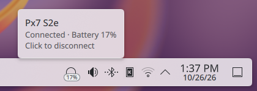
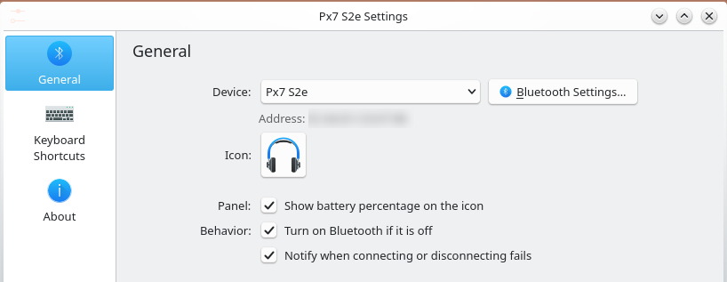

<h1>Bluetooth Quick Connect</h1>

A KDE Plasma 6 panel widget for one Bluetooth device, like your headphones. Available on the [KDE Store](https://store.kde.org/p/2380365).



- **Click** the icon to connect, click again to disconnect.
- **Hover** to see whether it's connected and its battery level.
- The icon is dimmed while disconnected and pulses while connecting.
- If Bluetooth is off, clicking turns it on first (can be disabled).
- Shows a notification if connecting fails, e.g. when the device is off or out of range.
- Optional battery percentage badge on the icon, like Plasma's battery widget.
- Right-click menu: Connect/Disconnect and Bluetooth Settings.
- Supports a global keyboard shortcut (Configure → Keyboard Shortcuts).

Want several devices? Add the widget once per device.



## Requirements

- KDE Plasma 6
- BlueDevil, the standard KDE Bluetooth stack (installed by default on most Plasma setups)

The widget uses the same BluezQt library as Plasma's own Bluetooth widget, so there's nothing extra to install.

Battery levels show up for devices that report them to BlueZ, which most modern headphones do.

## Install

### From the KDE Store

Right-click your panel → **Add or Manage Widgets** → **Get New Widgets** → **Download New Plasma Widgets**, then search for **Bluetooth Quick Connect**. You can also get it from its [store page](https://store.kde.org/p/2380365).

### From a release

1. Download the `.plasmoid` file from the [latest release](https://github.com/D3SOX/plasma-bluetooth-quick-connect/releases/latest).
2. Install it:

   ```sh
   kpackagetool6 -t Plasma/Applet -i me.d3sox.bluetoothquickconnect-*.plasmoid
   ```

### From source

```sh
git clone https://github.com/D3SOX/plasma-bluetooth-quick-connect.git
cd plasma-bluetooth-quick-connect
./install.sh
```

This installs the widget for your user into `~/.local/share/plasma/plasmoids/`.

### Set it up

1. Pair your device in System Settings → Bluetooth, if you haven't already.
2. Right-click your panel → **Add or Manage Widgets**, search for **Bluetooth Quick Connect** and drag it onto the panel.
3. Right-click the new icon → **Configure…** and pick your device.

## Update

If you installed from a release, download the new `.plasmoid` and run:

```sh
kpackagetool6 -t Plasma/Applet -u me.d3sox.bluetoothquickconnect-*.plasmoid
systemctl --user restart plasma-plasmashell
```

If you installed from source:

```sh
cd plasma-bluetooth-quick-connect
git pull
./install.sh
systemctl --user restart plasma-plasmashell
```

Plasma keeps the old version loaded until it restarts, which is why the last command is needed. You can also just log out and back in.

## Uninstall

Remove the widget from your panel, then run:

```sh
kpackagetool6 -t Plasma/Applet -r me.d3sox.bluetoothquickconnect
```

## Build a `.plasmoid` package

```sh
./build.sh   # writes dist/me.d3sox.bluetoothquickconnect-<version>.plasmoid
```

Pushing a `v*` tag that matches the version in `package/metadata.json` builds this file and publishes it as a GitHub release.

## License

[GPL-2.0-or-later](LICENSE)
